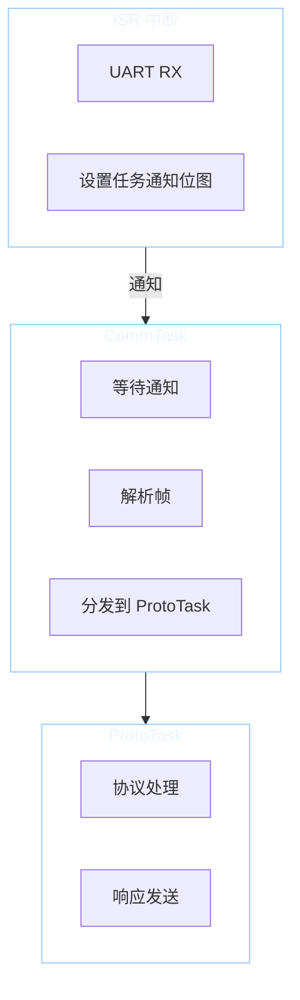

## 九、UART 错误恢复流程

CommTask 的 <code>app_main_consume_uart_recovery_flags()</code> 消费来自 ISR 的位图（<code>HAL_UART_ErrorCallback</code> 在中断中设置 <code>s_uart_recovery_needed</code>）。三种错误类型：overrun error（溢出）、noise error（噪声）、framing error（帧错误）。

恢复调用链：<code>HAL_UART_ErrorCallback (ISR)</code> → set bit in <code>s_uart_recovery_needed</code> → <code>CommTask</code> → <code>app_main_consume_uart_recovery_flags()</code> → <code>bsp_uart_port_rx_restart()</code>。

<code>bsp_uart_port_rx_restart()</code> 执行：tail=0, started=0, 清零 DMA 缓冲 → <code>HAL_UART_Receive_DMA()</code> 重新启动。注意：正在进行的 TX DMA 不受影响，只重启 RX。

<table>
<thead>
<tr>
<th>错误码</th>
<th>类型</th>
<th>恢复动作</th>
</tr>
</thead>
<tbody>
<tr>
<td>HAL_UART_ERROR_ORE</td>
<td>Overrun (溢出)</td>
<td>重启 RX DMA，丢弃溢出字节</td>
</tr>
<tr>
<td>HAL_UART_ERROR_NE</td>
<td>Noise (噪声)</td>
<td>重启 RX DMA</td>
</tr>
<tr>
<td>HAL_UART_ERROR_FE</td>
<td>Framing (帧错误)</td>
<td>重启 RX DMA</td>
</tr>
</tbody>
</table>

## 十、TX DMA 续传机制

<code>bsp_uart_start_tx_dma()</code> 每端口检查：busy==0 &amp;&amp; 队列非空 → 最多复制 64 字节到线性 dma_buf → <code>HAL_UART_Transmit_DMA()</code>。

DMA 完成回调（ISR）只做两件事：busy=0, kick_pending=1。下一周期 <code>bsp_uart_task_once()</code> 在任务上下文中启动下一段 DMA。这避免了 <code>HAL_UART_Transmit_DMA()</code> 的重入问题（嵌套调用返回 HAL_BUSY）。

完整的发送生命周期 ASCII 图：

<pre><code class="language-text">Task 写队列 → DMA 发送第一段 → ISR 清标志 → bsp_uart_task_once 启动下一段 → ... → 队列空</code></pre>
<pre><code class="language-c">TX 队列 (RingBuf)
      │
      ▼  (bsp_uart_port_transmit 写入)
 ┌─────────────┐
 │  队列非空?   │ ← bsp_uart_start_tx_dma 检查
 └──────┬──────┘
        │ yes
        ▼
 ┌─────────────────────┐
 │ 复制 ≤64B → dma_buf │
 │ HAL_UART_Transmit_DMA│
 └──────────┬──────────┘
            │
            ▼  (DMA 传输完成)
 ┌─────────────────────┐
 │ ISR: busy=0         │
 │      kick_pending=1 │
 └──────────┬──────────┘
            │
            ▼  (下一周期 bsp_uart_task_once)
 ┌─────────────────────┐
 │ 队列空? → 结束       │
 │ 非空   → 启动下一段   │
 └─────────────────────┘</code></pre>

## 十一、整包入队原子性保证

<code>bsp_uart_port_transmit()</code> 在入队任何字节前等待直到整个数据包能放进 TX 队列。防止半帧交织。

<pre><code class="language-text">// 等待直到队列有足够空间容纳整包
while (ringbuf_available(tx_queue) &lt; len) {
    // 让出 CPU，等待 DMA 消费
    taskYIELD();
}
// 整包一次性入队
ringbuf_write(tx_queue, data, len);
// 触发发送
bsp_uart_start_tx_dma(port);</code></pre>
